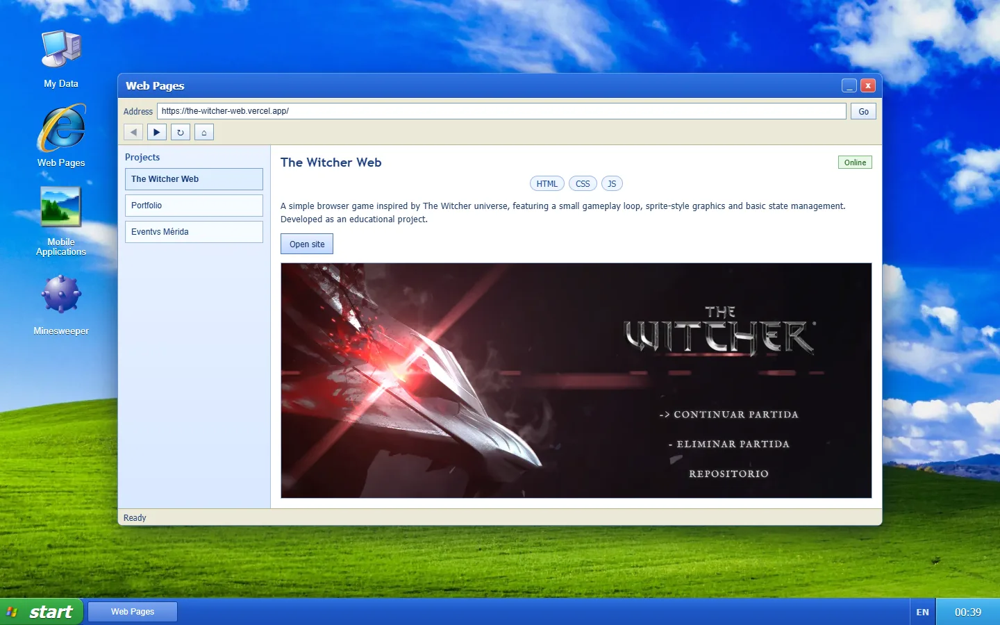
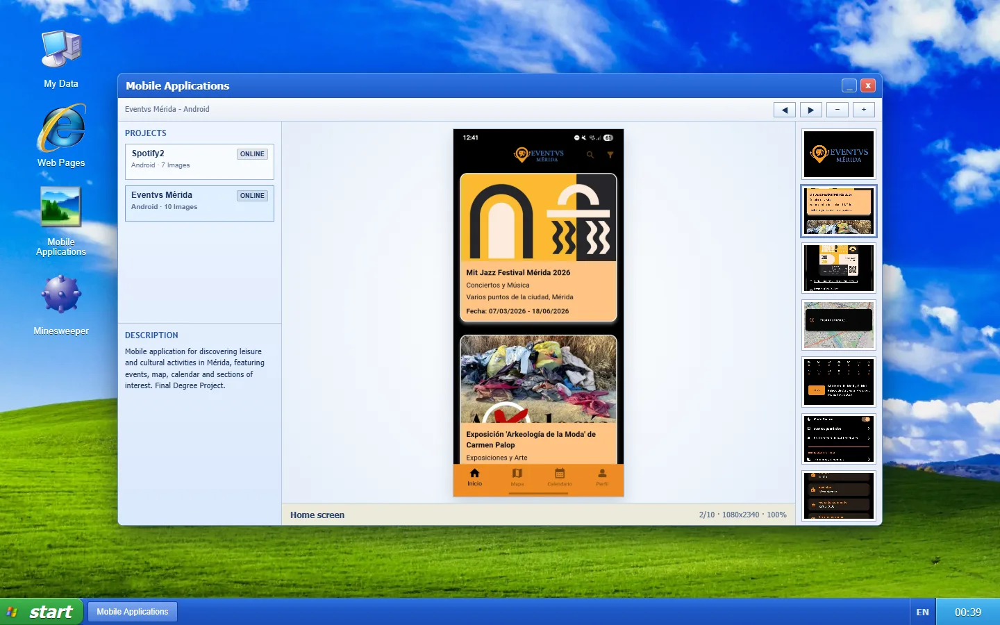
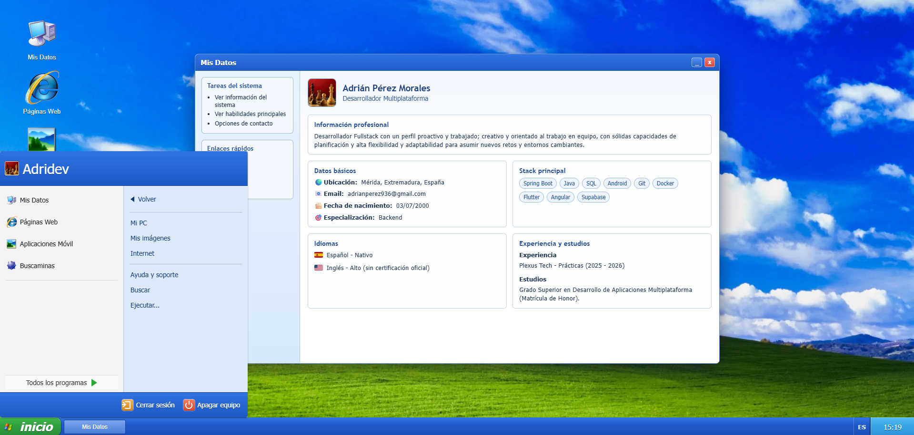
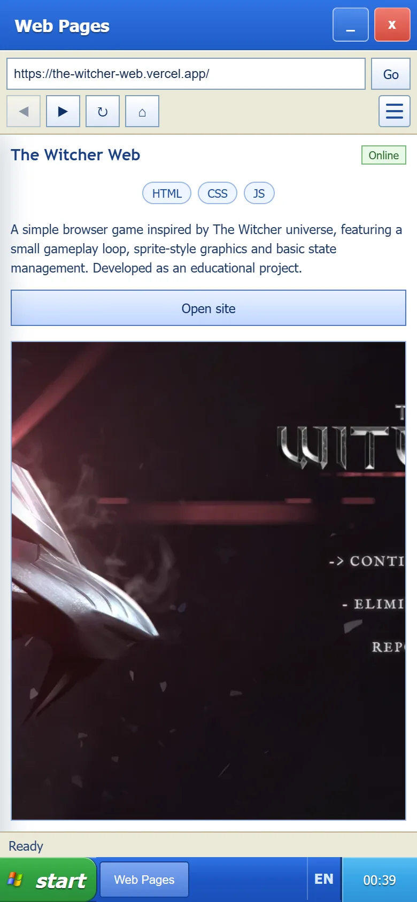

<div align="center">

# 🖥️ Portfolio XP

### A personal portfolio that brings the Windows XP experience to the web


[](https://adrianpmdev-portfolio.vercel.app/)
[](https://github.com/adrianpmdev)

</div>

---

<br>

## 🌐 Live Demo

👉 **[adrianpmdev-portfolio.vercel.app](https://adrianpmdev-portfolio.vercel.app/)**

---

<br>

## 📸 Screenshots

<p align="center">
  
</p>

<table>
  <tr>
    <td width="40%"></td>
    <td width="40%"></td>
    <td width="20%"></td>
  </tr>
  <tr>
    <td align="center">Mobile projects in the Photo Viewer</td>
    <td align="center">Start menu and profile</td>
    <td align="center">Mobile layout</td>
  </tr>
</table>

---

<br>

## 📖 Description

Personal portfolio built with **Angular** that recreates the visual experience of **Windows XP** in a web format.

The project combines a retro interface (**boot screen, login, desktop, windows and Start menu**) with an interactive presentation of projects and skills.

> 🕹️ **Boot → Login → Desktop**: the full XP experience, adapted to a modern context.

---

<br>

## 🎯 Purpose

- 🌟 Showcase personal projects through a more original and memorable experience than a traditional portfolio.
- 🧩 Demonstrate frontend development skills with a modular architecture, strong typing and separation of responsibilities.
- 🌍 Apply internationalization and animations to improve the user experience.
- 🎨 Keep a consistent Windows XP-inspired aesthetic, adapted to a modern context.

---

<br>

## 🛠️ Tech Stack

| Technology                                                                                                                  | Purpose                                                               |
| --------------------------------------------------------------------------------------------------------------------------- | --------------------------------------------------------------------- |
|                    | Core framework: standalone components, signals, zoneless              |
|              | Typed language                                                        |
|                                | Styling                                                               |
|     | UI components (menus, progress bars, ripples)                         |
|                           | Animations                                                            |
|  | Internationalization (🇪🇸 ES / 🇬🇧 EN / 🇫🇷 FR)                          |
|                          | Hosting and serverless function that forwards visit events to Discord |
|                          | Linting with angular-eslint rules                                     |
|                    | Code formatting                                                       |

---

<br>

## 🏗️ Project Approach

- 🧱 Architecture based on **standalone components**, following the official [Angular style guide](https://angular.dev/style-guide) (feature folders, no type suffixes).
- 📂 Code organized in `core`, `shared` and `features`:

```
src/app/
├── app.ts · app.config.ts · app.routes.ts
│
├── core/                             # App-wide singletons, no UI
│   ├── analytics/                    # Event logging
│   ├── device/                       # Device category and platform detection
│   ├── fullscreen/                   # Browser fullscreen
│   ├── i18n/                         # Supported languages and language settings
│   └── session/                      # User session
│
├── shared/                           # Pieces used by several features
│   ├── profile/                      # Author contact details (single source)
│   └── project-status/               # Project status model + label pipe
│
└── features/
    ├── boot/                         # Boot screen route
    ├── login/                        # Login route
    │
    ├── desktop/                      # Desktop route
    │   ├── desktop.ts
    │   ├── desktop-guard.ts          # Protects the desktop route
    │   ├── window-manager.ts         # Window state (open, minimized, focus, z-order)
    │   ├── desktop-window.ts
    │   ├── desktop-icon/
    │   ├── start-menu/               # XP Start menu
    │   ├── taskbar/                  # Start button, window tabs, language, clock
    │   └── xp-window/                # XP window frame that lazy-loads each app
    │
    └── apps/                         # Desktop applications
        ├── app-definition.ts         # Contract every app implements
        ├── app-registry.ts           # List of installed apps
        ├── app-window.ts             # Window context provided to each app
        ├── my-pc/
        │   ├── my-pc-manifest.ts
        │   └── skills-data.ts
        ├── internet-explorer/
        │   ├── internet-explorer-manifest.ts
        │   └── web-projects-data.ts       # Web projects
        ├── photo-viewer/
        │   ├── photo-viewer-manifest.ts
        │   └── mobile-projects-data.ts    # Mobile projects
        └── minesweeper/
            ├── minesweeper-manifest.ts
            └── minesweeper-engine.ts      # Game logic, UI-independent
```

- 🧩 **Pluggable apps**: each app lives in its own folder with a manifest (`<app>-manifest.ts`). Adding one means creating its folder and listing its manifest in `features/apps/app-registry.ts`; the desktop, Start menu and taskbar pick it up automatically and its code is lazy-loaded.
- 🗂️ **Data-driven projects**: web and mobile projects live in `features/apps/internet-explorer/web-projects-data.ts` and `features/apps/photo-viewer/mobile-projects-data.ts`, so adding a project doesn't require touching any component.

- 🔐 Client-side user session management to control the boot / login / desktop flow.
- 🎭 Interface focused on the visual experience and the narrative of the portfolio.
- 📱 **Responsive design**: on mobile, windows are displayed fullscreen and stacked, like native app screens.
- ⚡ **Zoneless, signals and OnPush**: the app runs without `zone.js`; component state lives in signals and every component uses `OnPush` change detection.

---

<br>

## 🧑‍💻 Development

| Command                | What it does                            |
| ---------------------- | --------------------------------------- |
| `npm start`            | Dev server at `http://localhost:4200`   |
| `npm run build`        | Production build in `dist/`             |
| `npm run lint`         | ESLint with angular-eslint rules        |
| `npm run format`       | Format the project with Prettier        |
| `npm run format:check` | Check formatting without changing files |
| `npm run images`       | Convert new or replaced images to WebP  |

### 🖼️ Adding or replacing images

1. Drop the image (PNG, JPG, GIF, TIFF or AVIF) into its folder under `public/assets/images/`. To replace an image, use the same name as the current `.webp` (for example `project1.png` replaces `project1.webp`).
2. Run `npm run images` (add `-- --dry-run` to preview it first). Each image is resized, converted to WebP and the original is deleted.
3. Reference the `.webp` file in the code; the command lists any file that still points to the original name.

| Folder                   | Result                             |
| ------------------------ | ---------------------------------- |
| `system/apps/`           | App icon, 144 × 144 px             |
| `webs/`                  | Web project preview, 1280 px wide  |
| `mobile/`                | Mobile screenshot, full resolution |
| `system/background_xp.*` | Desktop background, 2560 px wide   |
| `system/logo_xp.*`       | Logo, 440 px wide                  |
| `system/avatar_xp.*`     | Avatar, 256 × 256 px               |
| Anywhere else            | Up to 1920 px wide                 |

The favicon, the Apple touch icon and the Open Graph image keep their PNG/JPG format and are never converted.

---

<br>

## 📄 License

Source code licensed under the **MIT License**. Personal content and Windows XP assets are excluded. See [LICENSE](LICENSE) for details.

---

<br>

## 👤 Author

[@adrianpmdev](https://github.com/adrianpmdev) · Junior Full Stack Developer

---

<br>

<div align="center">

✨ Made in **2026** by [@adrianpmdev](https://github.com/adrianpmdev) ✨

</div>
